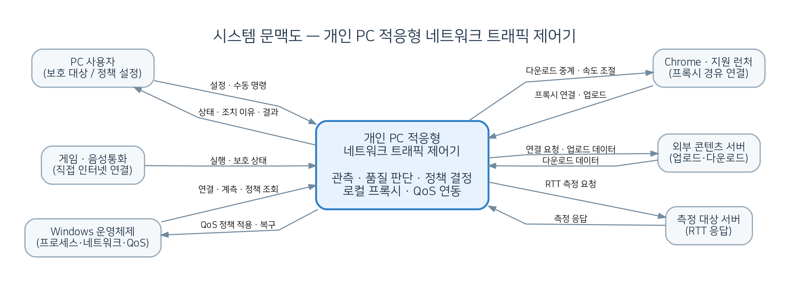

# 실시간 통신 품질 보호를 위한 개인 PC 적응형 네트워크 트래픽 제어기

**[과제 1: 프로젝트 관리]** 범위 정의(Scope Definition), 이해관계자 및 대상 시스템 분석  
**프로젝트 기간:** 한 학기(15주 가정) / **개발 인력:** 1명 / **대상 플랫폼:** Windows 11  
**작성 기준:** 프로젝트 전체 개발을 계획하며, 클래스 세부 설계는 후속 과제에서 수행한다.

---

## 1단계: 대상 제어기 선택

- **제어기 이름:** 개인 PC용 적응형 네트워크 트래픽 제어기(Adaptive Personal Network Traffic Controller)
- **역할:** Windows PC에서 게임과 음성통화 등 실시간 통신 프로그램의 활성화 여부와 네트워크 상태를 관찰하고, 통신 품질이 저하되는 상황에서 선택된 대용량 다운로드·업로드 트래픽의 전송률을 자동 조절한다. 통신 품질이 안정적일 때는 제한을 최소화하고, 보호 대상이 종료되면 제한을 해제한다.
- **제어 대상:** 사용자 PC에서 발생하는 애플리케이션별 네트워크 전송 정책. **보호 대상**(예: 게임, Discord)은 원칙적으로 직접 통신하고, **제한 대상**(예: Chrome의 대용량 전송, 지원되는 게임 런처 다운로드)은 로컬 프록시를 경유한다. 별도로 Windows QoS를 통한 송신 트래픽 제어를 연동한다.
- **제어 계층:** 애플리케이션 실행·연결 정보 수집 → 품질 평가 및 정책 결정 → 로컬 프록시·Windows QoS에 제어 명령 적용 → 결과 재측정의 피드백 제어 구조.
- **선정 이유:** 대용량 다운로드 중 게임 화면의 프레임은 정상이어도 순간적인 지연 증가, 지터 또는 패킷 손실로 통신 품질이 저하될 수 있다. 본 제어기는 단순히 게임에 고정 대역폭을 예약하는 대신, **실시간 통신 품질이 유지되는 한 대용량 전송에 최대한의 네트워크 자원을 허용**하는 데 목적이 있다. 실제 하드웨어를 개발하지 않고 PC 소프트웨어로 설계·검증할 수 있다.

---

## 2단계: 프로젝트 범위 정의

### 2.1 프로젝트 목표(Objectives)

1. 사용자가 지정한 게임·음성통화 프로그램의 실행 및 통신 활성 상태를 식별하고, 보호 대상을 설정·관리한다.
2. 네트워크 품질을 RTT, RTT 변동성(지터의 참고 지표), 관측 가능한 손실률, 송·수신 전송률 등으로 평가한다. **별도 측정 대상의 RTT는 게임 서버의 실제 핑과 동일하지 않음**을 구분한다.
3. 보호 대상이 비활성 상태이거나 품질이 안정적인 경우 대용량 전송에 불필요한 제한을 적용하지 않는다.
4. 보호 대상이 활성화된 상태에서 지속적인 품질 저하와 제어 가능한 대용량 전송 부하가 함께 관찰되면 송·수신 속도를 단계적으로 제한한다. 안정화되면 제한을 점진적으로 완화하고, 보호 대상 종료 시 해제한다.
5. HTTP/HTTPS `CONNECT`를 지원하는 **선택적 로컬 프록시**로 지정 애플리케이션의 전송을 중계하며, Windows 정책 기반 QoS를 사용한 송신 트래픽 제한도 실제 연동한다.
6. 대용량 전송을 통제하지 않은 상태와 제어를 적용한 상태의 지연 분포·손실·전송률을 비교하여 제어 효과 및 부작용을 검증한다.

**프로젝트 성과 목표(시험 가정값):** 통제된 네트워크 혼잡 시험에서 미제어 상태 대비 측정 대상 RTT의 95백분위 지연 증가분을 30% 이상 줄이는 것을 *시험 목표*로 설정한다. 이는 설계 목표이지 실제 성능이 입증되었다는 의미는 아니다. 혼잡이 없는 경우에는 제어 없이 전송률을 최대한 활용하는지 함께 평가한다.

### 2.2 범위 포함 사항(In-Scope)

**[필수 구현 — 한 학기 내 완료 목표]**

| 항목 | 내용 |
|---|---|
| 보호 대상 관리 | 사용자가 게임·음성통화 프로그램을 보호 목록에 등록·해제한다. 등록한 프로그램의 프로세스 실행 상태와 관측 가능한 연결 상태를 식별한다. |
| 네트워크 품질 측정 | 설정한 측정 대상에 대한 RTT 샘플, 지연 변동, 요청 실패 비율 등을 수집하고, 네트워크 인터페이스 송·수신량을 측정한다. 게임 내부 실제 RTT·패킷 손실을 항상 확보할 수는 없으므로 별도 참고 지표임을 표시한다. |
| 네트워크 기준선 | 실시간 통신이 안정적인 조건에서 지연·전송량 기준선을 생성한다. 다운로드와 업로드는 회선 용량 및 혼잡 원인이 다를 수 있으므로 분리 평가한다. |
| 선택적 로컬 프록시 | PC 내부 HTTP 프록시 및 HTTPS `CONNECT` 터널을 구현한다. 설정한 애플리케이션이 지원하는 연결을 프록시로 경유시킨다. HTTPS 본문을 해독하거나 변경하지 않는다. |
| 프록시 송·수신 제한 | 연결별·애플리케이션 그룹별 전송률 제한(Token Bucket 등)을 적용한다. 다운로드 방향은 상류 서버에서 과도하게 읽어 쌓지 않도록 버퍼를 제한하며 TCP 흐름 제어에 의한 전송률 감소를 검증한다. 업로드도 프록시 경유 구간에 속도 상한을 적용한다. |
| 적응형 제어 엔진 | `비보호/감시/제한/완화/복구` 상태를 관리한다. 일정 기간의 품질 악화가 확인될 때 제한을 강화하고, 안정 시 단계적으로 완화한다. 일시적인 지연 상승에 잦게 반응하지 않도록 유지 시간과 히스테리시스를 적용한다. |
| Windows QoS 연동 | Windows 정책 기반 QoS를 활용하여 지정된 송신 트래픽에 대한 정책 생성·조회·변경·제거를 구현하고, 정책 적용 여부 및 종료 시 원상복구를 검증한다. |
| 우선 호환성 검증 | **Chrome**을 필수 종단 간 시험 대상으로 정해 브라우저 프록시 경유와 다운로드·업로드 전송률 제한을 검증한다. **Epic Games Launcher**는 공식 프록시 설정을 통한 실제 게임 다운로드 경유 여부를 시험·기록한다. 경유하지 않는 연결을 지원한다고 주장하지 않는다. |
| 사용자 화면·기록 | 보호 대상 목록, 프록시 상태, 현재 전송률, 제한 적용 이유, 측정 품질, 적용·해제 이력 및 오류 정보를 표시한다. |
| 실험·검증 | 자체 TCP/HTTP 시험 서버 및 통제된 다운로드·업로드 시나리오로 속도 제한 정확성, 지연 개선 여부, 통신 오류, 프록시 장애 시 복구를 검사한다. |

**[선택 구현 — 여유 시 진행]**

- Steam의 실제 게임 다운로드 연결 경유 여부 실험 및 지원 범위 확대
- Battle.net과 Riot Client의 설치·업데이트 연결 특성 분석 및 호환성 검증
- 브라우저 다운로드 상태와 프록시 흐름을 연계하여 일반 웹 탐색보다 대용량 전송에 제어를 집중하는 기능
- 사용자 이용 패턴별 제어 프로필 자동 선택 및 알고리즘 매개변수 최적화

**지원 범위 주의:** Chrome의 프록시 설정은 일반 브라우징 연결에도 적용될 수 있고, 암호화된 HTTPS `CONNECT` 터널의 내용만으로 파일 다운로드·업로드를 정확하게 구별하기 어렵다. 따라서 필수 기능은 **사용자가 선택한 Chrome 프록시 세션/연결의 전송률 제어**를 우선하며, 파일 전송만 완벽히 식별하는 기능은 선택 구현으로 둔다. Epic의 공식 프록시 설정 존재가 *실제 게임 파일 데이터의 전부가 해당 프록시를 통과함*을 뜻하지는 않는다.

### 2.3 범위 제외 사항(Out-of-Scope)

- 라우터·스위치·공유기 및 통신사 네트워크 장비의 직접 제어, 별도의 하드웨어 개발
- Windows 커널 드라이버 또는 WFP Callout 드라이버 신규 제작, 모든 앱을 강제로 경유시키는 투명 프록시
- 게임 패킷 및 Discord 실시간 음성 트래픽 자체의 지연·차단·수정, 실시간 통신 내용 분석
- 프록시 우회 연결까지 포함한 **모든** Steam·Battle.net·Riot 전송의 완전한 제어 보장
- 모든 UDP/QUIC 프로토콜에 대한 통합 속도 제한 및 HTTPS 복호화·인증서 중간자 방식
- 통신사 장애·외부 서버 문제·다른 PC에서 발생한 트래픽에 대한 해결 보장, 모든 환경에서 특정 핑(예: 20ms) 보장

---

## 3단계: 시스템 문맥도 및 이해관계자 분석

### 3.1 시스템 문맥도(Context Diagram)

*그림 1. 중앙의 대상 시스템과 사용자, 보호 프로그램, 제어 대상 프로그램, Windows 서비스, 외부 서버 사이의 정보·제어 흐름. 프록시로 경유되지 않는 보호 프로그램의 데이터는 직접 인터넷으로 전달된다.*

| 외부 개체 | 제어기로 들어오는 데이터(입력) | 제어기에서 나가는 데이터(출력) |
|---|---|---|
| PC 사용자 | 보호·제한 대상 설정, 허용 속도·자동 모드 설정, 수동 해제 | 상태 대시보드, 제어 이유·경고, 결과 보고서 |
| 게임·음성통화 프로그램 | 실행·통신 활성 정보(운영체제에서 관측), 품질 보호 필요 상태 | 원칙적으로 데이터 경로에 개입하지 않음(보호 정책 적용 판단에 활용) |
| Chrome / Epic 등 지원 애플리케이션 | 프록시 경유 요청, 업로드 데이터 | 다운로드 데이터 중계, 전송률 제한에 따른 전달 |
| Windows 운영체제·QoS | 프로세스/연결 메타데이터, 네트워크 계측, 기존 QoS 정책 조회 결과 | 정책 생성·변경·삭제 요청, 원상복구 요청 |
| 외부 콘텐츠 서버 | 프록시가 수신하는 다운로드 데이터, 연결 응답 | 프록시가 전달하는 연결 요청·업로드 데이터 |
| 품질 측정 대상 | RTT 측정 응답 | RTT 확인 요청(게임 서버 내부 핑과 구분) |

**데이터 흐름 특성:** 로컬 프록시는 선택한 연결을 위한 중계 계층이며 전송 내용의 소유자가 아니다. 보호 대상 게임·음성통화의 데이터 흐름은 원칙적으로 프록시 외부에 남고, 제어기는 실행 상태 및 간접 품질 지표를 기반으로 *제한 대상*의 전송률을 조정한다.

### 3.2 이해관계자 분석(사용자 측면)

| 이해관계자 | 유형 | 역할 및 관심사 |
|---|---|---|
| 일반 PC 사용자 / 게이머 | 직접 사용자 | 게임·통화가 끊기지 않는 환경을 원하며, 복잡한 네트워크 설정 없이 자동 제어와 원상복구를 기대함 |
| 원격 회의·음성통화 사용자 | 직접 사용자 | 다운로드 작업과 병행해도 통신 품질이 안정적이고 음성 지연이 적기를 기대함 |
| 프로그램 설정·관리 사용자 | 직접 사용자 | 보호 목록, 제한 대상, 정책 적용 이유, 지원 프로그램·미지원 연결 범위를 명확히 확인하고자 함 |
| 소프트웨어 개발·유지보수자 | 간접 사용자 | 프록시 호환성과 오류 처리, 계측·제어 모듈의 분리, 설정 복구의 안정성을 중시함 |
| 시험평가 담당자 | 간접 사용자 | 품질 저하 재현, 정책 적용 전후 비교, 재현 가능한 시험 결과 및 한계 확인을 중시함 |

---

## 4단계: 제약사항 조사

### 4.1 시스템 제약사항

아래 수치는 별도 표시가 없는 한 **설계·시험을 위한 가정값**이며 실제 동작을 검증하고 조정한다.

| 구분 | 제약사항 |
|---|---|
| 제어 범위 | 개인 Windows PC 한 대에서, 지원하는 로컬 프록시 경유 TCP 연결과 Windows QoS에서 처리 가능한 송신 정책만 직접 제어 |
| 프록시 호환성 | Chrome은 공식 프록시 설정 경로가 있으나 일반 웹 연결도 함께 경유될 수 있음. Epic은 프록시 설정이 있어도 실제 게임 파일 트래픽 전부의 경유 여부는 시험 필요. 기타 런처는 지원 보장 불가 |
| TLS·프로토콜 | HTTPS `CONNECT`는 암호화된 바이트를 중계하며 내용 분석을 하지 않음. UDP/QUIC 및 프록시를 우회하는 연결은 직접 제어 범위에서 제외 |
| 송·수신 차이 | Windows 정책 기반 QoS의 속도 제한은 송신 트래픽 위주이며, 다운로드는 프록시 TCP 연결의 읽기·쓰기 속도 및 버퍼 제어를 통해 간접 제어 |
| 제어 응답성 | 품질 관측은 기본 1초 간격, 제한 상태 판단은 최근 5~10초의 관측값으로 수행(시험 가정). 정책 반응 속도는 실험으로 확인 |
| 품질 지표 | 외부 측정 대상 RTT·지연 변동은 게임 내부 실제 핑/손실률을 대체하지 못함. 측정 실패가 원격 서버 문제인지 로컬 혼잡인지 단독으로 확정할 수 없음 |
| 제한 알고리즘 | 정상 상태에서는 속도 상한 미설정. 지속적 혼잡이 확인되면 제한을 단계적으로 적용하고, 안정 후 복구. 과도한 조절 반복 방지를 위한 최소 유지 시간과 해제 규칙 필요 |
| 성능·안정성 | 프록시 버퍼 상한을 설정해 무제한 적재 방지. 프록시 오류·종료 시 기존 QoS 규칙 복구 및 안전한 연결 종료/재시도 지원 |
| 접근 권한 | Windows QoS 정책 변경 및 일부 계측 작업에는 관리자 권한 또는 운영체제 설정이 필요할 수 있음 |
| 네트워크 구조 | 실제 혼잡 원인이 통신사·공유기·타 기기에 있다면 본 소프트웨어의 제어 효과가 제한적임 |

### 4.2 프로젝트 제약사항

| 구분 | 제약사항 |
|---|---|
| 인력·일정 | **1인 개발, 한 학기(15주 가정)에 전체 필수 기능 구현·시험·보고까지 완료 목표.** 과제 1은 이 전체 프로젝트의 기획 단계에 해당함 |
| 인력 투입 | 주당 약 16시간, 전체 **240시간** 작업량을 계획값으로 설정. 학업 일정과 통합 오류 발생 시 선택 기능을 축소해 일정 확보 |
| 개발 환경 | Windows 11, C#/.NET(WPF 사용자 화면·제어 로직), .NET 비동기 Socket/HTTP CONNECT 프록시, PowerShell NetQos 명령·Windows API, SQLite 또는 파일 기반 기록, VS Code/Visual Studio, Git |
| 하드웨어 | 별도 네트워크 장비 개발 없음. 기존 PC와 인터넷 회선을 시험 환경으로 사용; 통제된 테스트용 로컬 HTTP/TCP 서버 사용 가능 |
| 비용 | 무료 개발 도구 및 기존 장비를 사용하며 유료 제어 제품 구매는 필수로 하지 않음. 실제 전기·통신 비용 등은 별도 산정하지 않음 |
| 범위 통제 | Chrome 종단 간 제어와 실제 Windows QoS 연동은 필수, Epic의 게임 파일 경유 여부는 검증·기록을 필수 산출물로 정의. 5개 런처 모두의 제어 성공은 필수 기준에 포함하지 않음 |

### 4.3 프로젝트 위험 및 대응

| No. | 위험 | 치명도 | 발생 가능성 | 대응 방안 |
|---|---|---|---|---|
| 1 | 특정 런처의 다운로드가 프록시를 우회함 | High | High | Chrome을 먼저 필수 대상으로 완성하고 Epic의 실제 경유 여부를 초기에 시험. 결과에 따라 추가 지원을 선택 기능으로 분리 |
| 2 | HTTPS 터널에서 파일 전송 여부를 구별하지 못함 | Mid | High | 초기에는 별도 Chrome 프로필/세션 단위로 제어. 파일 단위 선택 기능은 외부 신호 연계가 확인된 경우에만 구현 |
| 3 | 다운로드 제한에도 게임 핑이 개선되지 않음 | High | Mid | 측정용 RTT·업로드 부하·패킷 손실 및 외부 병목 가능성 비교. 개선이 없는 경우 자동 제한 강화 중단 및 진단 메시지 제공 |
| 4 | 프록시 중단·지연으로 웹·다운로드가 실패함 | High | Mid | 버퍼 상한, 시간 초과, 오류 로그, 재시도/우회 안내 및 사전 연결 확인. 완전 무중단 복구는 보장하지 않음 |
| 5 | QoS 정책 변경 후 원상복구 실패 | High | Mid | 시작 시 기존 정책 백업, 충돌 방지용 정책 이름, 정상 종료·비정상 복구 시험 및 관리자 권한 확인 |
| 6 | 한 학기 내 통합 구현 지연 | High | Mid | 프록시·계측·제어 엔진·QoS를 조기에 수직 통합하고 Steam/Battle.net/Riot 지원은 필수가 아닌 확장 범위로 통제 |

---

## 5단계: 프로젝트 규모 산정

현재 단계에서는 세부 클래스를 정의하지 않고 **대표 기능·상위 모듈**을 기준으로 산정한다. 향후 전체 소프트웨어는 약 30개 클래스 규모로 확장 가능한 중소규모 프로젝트로 계획하되, 클래스 개수는 설계 결과에 따라 달라질 수 있다. 아래 모든 수치는 아직 구현 전의 **예비 추정치**다.

### 5.1 LOC 기법

3점 추정식을 사용한다.

`추정 LOC = (낙관치 + 4 × 기대치 + 비관치) / 6`

| 상위 모듈 | 낙관치 | 기대치 | 비관치 | 추정 LOC |
|---|---:|---:|---:|---:|
| 보호 대상 탐지·프로필 관리 | 300 | 450 | 700 | 466.7 |
| 네트워크 계측·품질 진단 | 450 | 700 | 1,100 | 725.0 |
| HTTP/CONNECT 로컬 프록시 | 700 | 1,150 | 1,800 | 1,183.3 |
| 송·수신 속도 제한 엔진 | 350 | 550 | 850 | 566.7 |
| 적응형 품질 평가·정책 결정 | 400 | 600 | 950 | 625.0 |
| Windows QoS 정책 연동 | 250 | 400 | 650 | 416.7 |
| 사용자 화면·이력 및 설정 | 450 | 700 | 1,100 | 725.0 |
| 모듈 통합·예외·복구 처리 | 400 | 650 | 1,000 | 666.7 |
| **합계** | **3,300** | **5,200** | **8,150** | **약 5,375 LOC (5.38 KLOC)** |

- 외부 라이브러리·프레임워크 소스 코드는 합계에 포함하지 않는다.
- 테스트 코드, 배포 스크립트 및 문서의 LOC는 별도이며 실제 총 파일 줄 수는 더 많아질 수 있다.
- Chrome 프록시 경유·속도 제한, 품질 피드백, 실제 Windows QoS 통합을 포함한 추정이다.

### 5.2 기능점수(FP) 기법

**(1) 기능 식별 — 과제 단계의 개략 분류**

| 유형 | 기능 예시 |
|---|---|
| ILF(내부 논리 파일) | 보호·제한 대상 설정, 사용자별 정책·프로필, 통신 품질 관측 이력, 제어 이력 |
| EIF(외부 인터페이스 파일) | 운영체제가 별도로 관리하는 정책/설정 데이터 중 제어기가 조회하는 논리 정보(가정) |
| EI(외부 입력) | 대상 앱 등록·변경, 자동 모드 설정, 품질 목표 입력, 제한값 수정, 수동 제어·해제 |
| EO(외부 출력) | 제어 정책 적용 결과, 품질 변화 분석, 제한·해제 사유, 오류 알림, 시험 결과 요약 |
| EQ(외부 조회) | 실시간 상태 조회, 제어 이력 조회, 등록 앱·정책 조회 |

**(2) 간이 미조정 기능점수(UFP)**

친구 보고서와 비교 가능하도록 간이 평균 복잡도 가중치를 사용한다. 실제 공식 FP 산정에는 세부 데이터 요소·논리 파일·트랜잭션 경계 분석이 추가로 필요하다.

| 구분 | 유형 | 기능 수 | 평균 가중치 | 점수 |
|---|---|---:|---:|---:|
| 데이터 기능 | ILF | 4 | 7.5 | 30.0 |
| | EIF | 1 | 5.4 | 5.4 |
| 트랜잭션 기능 | EI | 5 | 4.0 | 20.0 |
| | EO | 5 | 5.2 | 26.0 |
| | EQ | 3 | 3.9 | 11.7 |
| **합계** | | | | **93.1 UFP** |

이 값은 **과제용 간이 추정**이다. 프록시·TCP 제어 알고리즘처럼 내부 구현 복잡도가 큰 부분은 FP만으로 개발 난이도를 잘 나타내지 못할 수 있어 LOC와 상향식 작업량 추정을 병행한다.

**(3) 외주 개발비의 참고 계산(실제 예산 아님)**

한국인공지능·소프트웨어산업협회의 「SW사업 대가산정 가이드(2025년 개정판)」에 게재된 기능점수당 605,784원(공식 가이드의 참고 단가)을 그대로 적용하면:

`93.1 UFP × 605,784원 = 약 56,398,490원 (보정 전 참고 원가)`

**(4) 규모 보정의 예시**

500FP 미만 규모에 대하여 예시 계수 1.28만 가정해 적용하면 `약 72,190,068원`이다. 실제 가이드의 보정은 사업 조건에 따라 추가 요소를 검토해야 하므로 이 계산은 **정식 견적이 아니다**.

**(5) 개발비 참고값과 실제 지출 구분**

| 구분 | 금액(참고값) | 의미 |
|---|---:|---|
| 보정 전 추정 원가 | 약 56,398,490원 | 간이 UFP에 참고 단가 적용 |
| 예시 규모 보정 후 원가 | 약 72,190,068원 | 규모 계수 1.28 가정 |
| 예시 이윤 25% 포함 | 약 90,237,585원 | 외주 가상 시나리오의 산술 예시, 실제 견적 아님 |
| 학기 프로젝트 직접 SW 도구 구매비 | 0원 계획 | 무료 도구·기존 PC 사용 가정 |

*주의:* 학기 프로젝트에 실제로 약 9천만 원이 필요하다는 뜻이 아니다. 과제에 명시적인 외주비 계산 의무가 없다면 이 항목은 비교용으로만 사용한다.

### 5.3 산정 결과의 적용

- **총 기능 규모:** 약 30개 클래스 수준으로 세부 객체지향 설계를 이어갈 수 있는 8개 상위 모듈. 현재 단계에서 클래스 세부명은 확정하지 않는다.
- **예상 소스 규모:** 약 5,375 LOC(대략적인 3점 추정 결과). 라이브러리 소스·테스트 코드 제외.
- **개발 기간·작업량:** 1인 × 15주 × 주 16시간 = **240시간**. 구현 난이도와 숙련도에 따라 실제 작업량은 크게 달라질 수 있다.
- **범위 우선순위:** 필수 모듈 및 Windows QoS 실제 연동 완료를 기준으로 하며, 타사 런처 추가 지원은 필수 기능 안정화 이후 판단한다.

---

## 6단계: 주요 업무 구분 및 WBS 연계

전체 기간은 한 학기 **15주**, 개발자 1명, 기준 작업량은 **주 16시간·총 240시간**으로 가정한다. 과제 1은 프로젝트 범위와 관리 계획을 정의하는 선행 단계이며, 아래 WBS는 **향후 전체 시스템 개발을 완료할 때까지**의 작업을 포함한다. 현재 실제 진척과 혼동하지 않도록 상태는 모두 '계획'으로 표시한다.

| WBS | 주요 업무 | 작업량(시간) | 예정 주차 | 상태 | 과제 내용 연계 |
|---|---|---:|---|---|---|
| **1** | **프로젝트 관리·요구 분석** | **20** | **1~2주** | 계획 | 1~5단계 |
| 1.1 | 대상 선정·프로젝트 범위 정의 | 8 | 1주 | 계획 | 1·2단계 |
| 1.2 | 문맥도·이해관계자 분석 | 5 | 1주 | 계획 | 3단계 |
| 1.3 | 제약·위험 조사 | 4 | 2주 | 계획 | 4단계 |
| 1.4 | 규모 산정 및 WBS 초안 | 3 | 2주 | 계획 | 5·6단계 |
| **2** | **소프트웨어 설계** | **28** | **2~3주** | 계획 | 2·3단계 |
| 2.1 | 요구사항·사용 시나리오 구체화 | 8 | 2주 | 계획 | 2단계 |
| 2.2 | 상위 모듈·인터페이스 설계 | 10 | 3주 | 계획 | 3단계 |
| 2.3 | 적응형 정책 상태 전이 설계 | 6 | 3주 | 계획 | 2단계 |
| 2.4 | 프록시·QoS 복구 및 예외 설계 | 4 | 3주 | 계획 | 4단계 |
| **3** | **핵심 기능 구현** | **141** | **4~12주** | 계획 | 2·4·5단계 |
| 3.1 | Windows 개발 환경·프로젝트 구조 | 8 | 4주 | 계획 | 4단계 |
| 3.2 | 보호 대상 앱 감지·연결 모니터링 | 22 | 4~5주 | 계획 | 2단계 |
| 3.3 | RTT·손실 관측 및 품질 분석 | 20 | 5~6주 | 계획 | 2단계 |
| 3.4 | HTTP/HTTPS CONNECT 로컬 프록시 | 30 | 6~8주 | 계획 | 2단계 |
| 3.5 | 송·수신 속도 제한·버퍼 관리 | 20 | 8~9주 | 계획 | 2단계 |
| 3.6 | 품질 기반 자동 제한·완화 엔진 | 18 | 9~10주 | 계획 | 2단계 |
| 3.7 | Windows QoS 실제 연동·원상복구 | 12 | 10~11주 | 계획 | 2·4단계 |
| 3.8 | 상태 화면·설정·이력 관리 | 11 | 11~12주 | 계획 | 2단계 |
| **4** | **통합 및 검증** | **38** | **12~14주** | 계획 | 4·5단계 |
| 4.1 | 모듈 단위 및 통합 테스트 | 10 | 12~13주 | 계획 | 4단계 |
| 4.2 | Chrome 필수 제어·Epic 호환성 검증 | 12 | 13주 | 계획 | 2·4단계 |
| 4.3 | 동시 다운로드·게임 품질 비교 시험 | 10 | 13~14주 | 계획 | 2·5단계 |
| 4.4 | 프록시 장애·QoS 원상복구 시험 | 6 | 14주 | 계획 | 4단계 |
| **5** | **문서화 및 최종 결과 정리** | **13** | **15주** | 계획 | 6단계 |
| 5.1 | 결과 분석·한계 및 개선점 정리 | 7 | 15주 | 계획 | 5단계 |
| 5.2 | 최종 보고서·시연 자료 작성 | 6 | 15주 | 계획 | 6단계 |
| | **합계** | **240시간** | **15주** | | |

WBS 수행 순서는 네트워크 계측 → Chrome 종단 간 프록시 → 속도 제한 → 정책 제어 → Windows QoS 연동 → 복구·통합 시험을 우선한다. 선택적 런처 확장은 필수 기능 완료 및 위험 검토 후 별도로 결정한다.

---

## 향후 확장 방향

- **런처 지원 확대:** Steam·Battle.net·Riot Client의 실제 콘텐츠 다운로드 프로토콜과 프록시 경유 가능성을 조사하고, 확인된 범위 안에서 제어 지원을 확대한다.
- **세부 트래픽 식별:** 브라우저 다운로드 상태와 네트워크 흐름을 연계하여 일반 탐색 통신과 대용량 파일 전송을 더 정확히 구분한다.
- **제어 알고리즘 개선:** RTT 95백분위, 지연 변동, 제한 후 효과를 함께 고려하는 적응형 탐색 알고리즘으로 개선한다.
- **OS 범위 확대:** 초기 Windows QoS·로컬 프록시 구조를 모듈화하여 다른 운영체제의 제어 기능으로 대체할 수 있도록 설계한다.

---

## 참고 자료

1. [Chromium — Network Settings / Proxy options](https://www.chromium.org/developers/design-documents/network-settings/) (Chrome의 프록시 지원 및 실행 옵션)
2. [Chromium — Proxy support in Chrome](https://chromium.googlesource.com/chromium/src/net/+/cdd9cf846ae1e72d11080e82f866c16a039a29b8/docs/proxy.md) (HTTP CONNECT 터널의 작동)
3. [Epic Games — How do I use a proxy server to connect to the Epic Games Launcher?](https://www.epicgames.com/help/c-32735058/c-36403860/a21635083?lang=en-US) (Epic의 프록시 설정과 지원 조건)
4. [Microsoft Learn — QoS Policy](https://learn.microsoft.com/en-us/windows-server/networking/technologies/qos/qos-policy-top) (정책 기반 QoS와 송신 속도 제한)
5. [Microsoft Learn — New-NetQosPolicy](https://learn.microsoft.com/en-us/powershell/module/netqos/new-netqospolicy?view=windowsserver2025-ps) (Windows QoS 정책 명령)
6. [Microsoft Learn — About Windows Filtering Platform](https://learn.microsoft.com/en-us/windows/win32/fwp/about-windows-filtering-platform) (고급 네트워크 제어의 기술적 범위 및 제약)
7. [RFC 8290 — FQ-CoDel](https://www.rfc-editor.org/rfc/rfc8290.html) (버퍼블로트·대기열 지연의 배경)
8. [한국인공지능·소프트웨어산업협회 — SW사업 대가산정 가이드(2025년 개정판)](https://www.sw.or.kr/site/sw/ex/board/View.do?bcIdx=63607&cbIdx=276) (규모·개발 원가 산정 참고)

> **작성 유의:** 본 문서는 구현을 완료한 결과 보고서가 아닌 **프로젝트 기획·관리 보고서**이다. 개발 성공 여부, 특정 앱 호환성 및 성능 수치는 후속 구현·시험을 통해 검증해야 한다.
